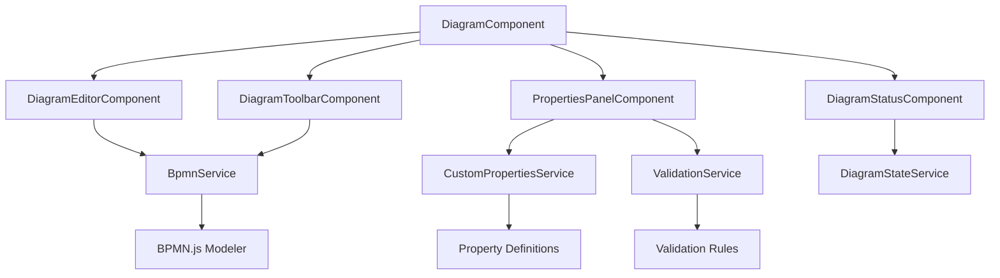

# System Architecture

## 🏗️ Overview

The BPMN Angular Integration project follows a layered, modular architecture designed for maintainability, testability, and extensibility. The architecture separates concerns into distinct layers while maintaining loose coupling between components.

## 📐 Architectural Layers

```
┌─────────────────────────────────────────┐
│             Presentation Layer          │
│  ┌─────────────┐ ┌─────────────────────┐ │
│  │ Components  │ │    Templates &      │ │
│  │             │ │      Styles         │ │
│  └─────────────┘ └─────────────────────┘ │
└─────────────────────────────────────────┘
┌─────────────────────────────────────────┐
│              Service Layer              │
│  ┌─────────────┐ ┌─────────────────────┐ │
│  │   Core      │ │   Custom Properties │ │
│  │  Services   │ │    & Validation     │ │
│  └─────────────┘ └─────────────────────┘ │
└─────────────────────────────────────────┘
┌─────────────────────────────────────────┐
│              Model Layer                │
│  ┌─────────────┐ ┌─────────────────────┐ │
│  │ TypeScript  │ │     BPMN.js         │ │
│  │ Interfaces  │ │   Integration       │ │
│  └─────────────┘ └─────────────────────┘ │
└─────────────────────────────────────────┘
```

## 🧩 Component Architecture

### Core Components

#### DiagramComponent
The main container component that orchestrates the entire BPMN editing experience.

**Responsibilities:**
- Create the modeler through `BpmnService.createModeler()` and load the default diagram
- Wire bpmn-js events (`selection.changed`, `element.changed`, `commandStack.changed`, `canvas.viewbox.changed`, `import.done`) to the services
- Handle toolbar `*Requested` outputs (import, export XML/SVG, backup, reset, zoom, undo/redo, properties toggle)
- Toggle the properties panel (side panel on desktop, bottom sheet on phones)

**Key Features:**
- Element selection forwarded to `DiagramStateService` and `CustomPropertiesService`
- Diagram import/export coordination through `FileService`

#### DiagramEditorComponent
The core BPMN diagram editing interface.

**Responsibilities:**
- Provide the canvas host element for the BPMN.js modeler
- Expose canvas helpers: `importXML`, `exportXML`, `exportSVG`, `zoomToFit`, `resetZoom`, `getZoom`/`setZoom`, `getSelection`, `selectElements`, `clearSelection`
- Emit `ready`, `error`, `selectionChanged`, `elementChanged` and `importDone`

**Integration Points:**
- Inputs: `initialXml`, `readonly`
- The modeler itself is created by `DiagramComponent`/`BpmnService`

#### PropertiesPanelComponent
Advanced properties management for BPMN elements.

**Responsibilities:**
- Display element-specific properties driven by `ElementSchemas` (UserTask, ServiceTask, ScriptTask, ExclusiveGateway, ParallelGateway, StartEvent, EndEvent, SequenceFlow; other types show an empty state)
- Handle property value changes and write them into the BPMN XML (`custom:Properties` extension elements)
- Show validation results

**Features:**
- Collapsible property groups
- One input per `PropertyType` via `PropertyInputComponent` (`app-property-input`)
- Real-time validation
- Property search, plus Properties / Validation / Preview tabs

#### DiagramToolbarComponent
Main toolbar with diagram operations.

**Responsibilities:**
- File actions: Import, Export XML, Export SVG, Backup, Reset
- Edit actions: Undo, Redo
- View actions: Fit, Zoom in, Zoom out, and the properties panel toggle
- Optional `customActions` input

#### DiagramStatusComponent
Status information and validation results.

**Responsibilities:**
- Display diagram name, saved/unsaved state and last-modified time
- Show the current selection and zoom level
- Show validation summary and a dismissible details popover

### Component Communication



## 🔧 Service Layer

### BpmnService
Core service for BPMN.js integration and operations.

**Key Methods:**
```typescript
class BpmnService {
  // Modeler lifecycle
  createModeler(config: BpmnConfig): Modeler
  getModeler(): Modeler | null
  attachModeler(diagramContainer: HTMLElement, propertiesContainer?: HTMLElement): void
  destroy(): void
  isReady(): boolean
  
  // Diagram operations
  importXML(xml: string): Observable<ImportResult>
  exportXML(options?: { format?: boolean }): Promise<ExportResult>
  exportSVG(): Promise<{ svg: string }>
  getDefaultXML(): string
  
  // Command stack (cached wrapper around the modeler's commandStack)
  getCommandStack(): CommandStack | null   // then .undo() / .redo() / .canUndo?() / .canRedo?()
}

// Element access goes through the modeler:
// bpmnService.getModeler().get('elementRegistry')
```

### CustomPropertiesService
Manages custom properties for BPMN elements with validation and business rules.

**Key Features:**
- Per-element property values initialised from the schema, defaults, or the saved XML
- Static schemas from `ElementSchemas`
- Business rule execution
- Property validation

**Core Methods:**
```typescript
class CustomPropertiesService {
  // Property management
  setSelectedElement(elementId: string | null, element?: any): void
  initializeElementProperties(elementId: string, element: any): void
  getElementProperties(elementId: string): EnhancedElementProperties | undefined
  setProperty(elementId: string, propertyName: string, value: any): void
  setProperties(elementId: string, properties: { [key: string]: any }): void
  getPropertyGroups(elementId: string): PropertyGroup[]
  
  // Schema operations (schemas are static, defined in models/element-schemas.ts)
  getElementSchema(elementType: BpmnElementType): ElementPropertySchema | undefined
  getSupportedElementTypes(): BpmnElementType[]
  
  // Business rules
  applyBusinessRules(elementId: string): void
}
```

### ValidationService
Comprehensive validation for BPMN diagrams and properties.

**Validation Types:**
- **Property Validation** - Schema constraints (`required`, `minLength`, `maxLength`, `min`, `max`, `pattern`, `email`, `url`, `custom`)
- **Cross-property Validation** - A few built-in checks for user and service tasks
- **Business Rules** - Schema `businessRules` whose `condition` is a JavaScript-style expression

Note: there is no BPMN structural/process validation (e.g. unconnected flows).

### DiagramStateService
Manages application state and provides reactive updates.

**State Management (`state$` BehaviorSubject, `actions$` stream):**
- Selected element
- Loaded / dirty flags, current XML and diagram name
- Last-modified timestamp

Validation results live in `ValidationService`, not here.

### FileService
Handles file operations for diagram import/export.

**Supported Formats:**
- BPMN XML files (import `.xml`/`.bpmn`, export `.xml`)
- SVG export
- JSON backups (`createBackup`)

## 🔗 Data Flow

### Property Update Flow
```
User Input → Component → Service → Validation → BPMN Model → UI Update
```

### Element Selection Flow
```
Canvas Click → BPMN.js Event → Service Update → Component State → Properties Panel
```

### Validation Flow
```
Model Change → Validation Service → Rules Engine → Results → Status Display
```

## 🎨 BPMN.js Integration

### Modeler Configuration
```typescript
const modelerConfig = {
  container: diagramContainer,
  propertiesPanel: {
    parent: propertiesContainer
  },
  additionalModules: [
    BpmnPropertiesPanelModule,
    BpmnPropertiesProviderModule,
    customPropertiesProvider
  ],
  moddleExtensions: {
    custom: customExtensions
  }
};
```

### Custom Properties Provider
Extends BPMN.js with domain-specific properties:

```typescript
function CustomPropertiesProvider(propertiesPanel, translate) {
  this.getGroups = function(element) {
    return function(groups) {
      if (is(element, 'bpmn:StartEvent')) {
        groups.push(createCustomGroup(element, translate));
      }
      return groups;
    }
  };
}
```

## 🔧 Extension Points

### Adding Custom Properties
1. Add a `PropertyDefinition` to the element's entry in `ElementSchemas` (`element-schemas.ts`)
2. Add a new input to `PropertyInputComponent` only if you need a new `PropertyType`
3. Add `validation` rules or `businessRules` if needed

### Custom Validation Rules
1. Add a `ValidationRule` to a property's `validation` array, or a `BusinessRule` to the schema's `businessRules`
2. Cross-property checks live in `ValidationService.performCrossPropertyValidation`

### New Component Integration
1. Create the Angular component with `standalone: false`
2. Inject required services
3. Implement lifecycle hooks (unsubscribe in `ngOnDestroy`)
4. Add it to the `declarations` in `app.module.ts`

## 🚀 Performance Optimizations

### Change Detection Strategy
- Default change detection (`OnPush` is not used)
- Reactive data flows with RxJS

### Memory Management
- Proper subscription cleanup
- Component destruction handling
- BPMN.js instance disposal

### Bundle Optimization
- No lazy loading (the app has no routes)
- Tree shaking for unused code
- Production budget per component stylesheet: 12 kB warning, 16 kB error

## 🏗️ Design Patterns

### Service Pattern
- Centralized business logic
- Dependency injection
- Single responsibility principle

### Observer Pattern
- Event-driven communication
- RxJS observables
- Reactive state management

### Strategy Pattern
- Pluggable validation rules
- Configurable property providers
- Flexible export formats

### Factory Pattern
- Property input creation
- Validation rule instantiation
- Component factory services

## 📱 Responsive Design

### Layout Strategy
- CSS Grid for main layout
- Flexbox for component arrangement
- Design tokens, dark mode (`prefers-color-scheme`) and a 767px mobile breakpoint in `src/styles.css`; no UI framework

### Mobile Considerations
- Under 768px the properties panel becomes a bottom sheet toggled by a floating button
- Adaptive toolbar layout

## 🔒 Error Handling

### Error Boundaries
- Editor errors surface through the `error` output and the status bar
- Services throw `Modeler not initialized` if used before `createModeler`

### Validation Pipeline
- Input validation
- Business rule validation
- Model consistency checks

## 🧪 Testing Strategy

### Unit Testing
- Service logic testing
- Component behavior testing
- Validation rule testing

### Integration Testing
- Component interaction testing (Vitest + Angular TestBed, jsdom)
- Service integration testing
- XML round-trip tests for persistence (bpmn-js is mocked in component specs)

---

This architecture provides a solid foundation for building complex BPMN applications while maintaining code quality, performance, and extensibility.
